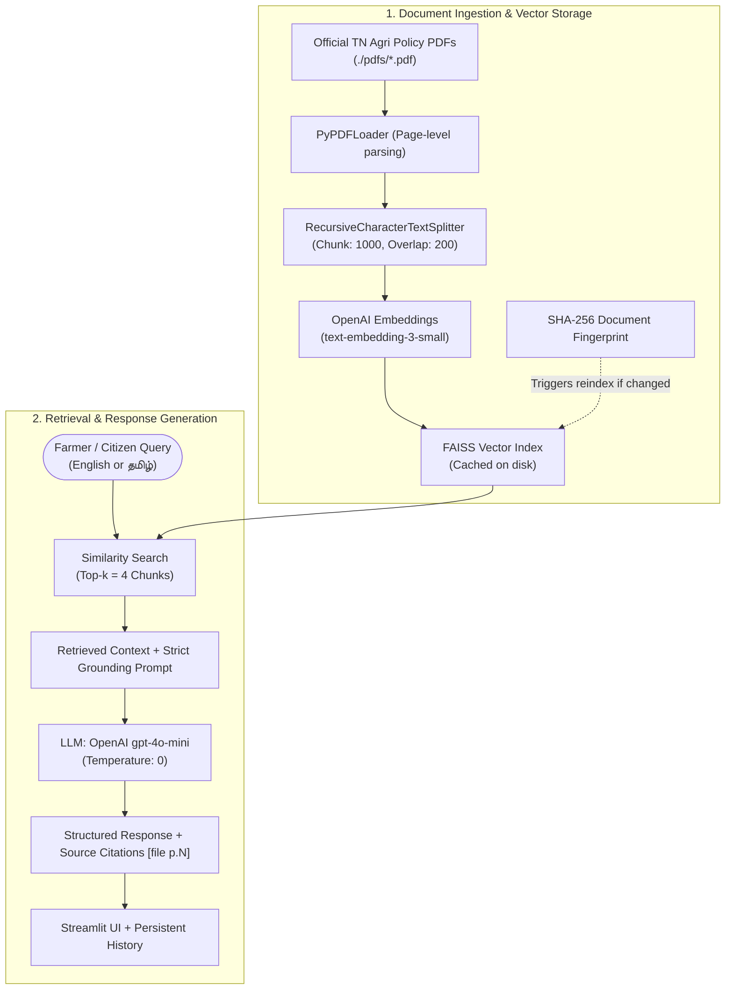

# 🌾 Tamil Nadu Agricultural Schemes Assistant (TN Agri Assistant)
### Retrieval-Augmented Generation (RAG) System for Farmer Welfare & Government Schemes

[](https://www.python.org/)
[](https://streamlit.io/)
[](https://www.langchain.com/)
[](https://github.com/facebookresearch/faiss)
[](https://openai.com/)
[](https://github.com/astral-sh/uv)

---

## 📌 Overview

**Tamil Nadu Agricultural Schemes Assistant** is an intelligent, bilingual AI-powered assistant built to bridge the gap between farmers, the general public, and official Government of Tamil Nadu agricultural policies. 

Accessing and understanding voluminous government policy notes, welfare schemes, subsidies, and eligibility rules can be difficult. This application leverages **Retrieval-Augmented Generation (RAG)** to index official government publications and policy notes, allowing users to query schemes in natural language in either **English** or **Tamil (தமிழ்)** and receive grounded, accurate, and structured guidance with page-level citations.

---

## ✨ Key Features

- **🌐 Multilingual Support (English & தமிழ்):** Queries in Tamil are answered in clear, accessible Tamil; queries in English are answered in English.
- **🛡️ Zero-Hallucination Guardrails:** Strict prompt conditioning ensures answers are synthesized **strictly** from official policy documents. The assistant never fabricates amounts, deadlines, or scheme rules.
- **📑 Structured Scheme Breakdown:** Automatically formats scheme details into clear sections:
  - **Scheme Name**
  - **Benefits & Subsidies**
  - **Eligibility Criteria**
  - **How to Apply**
  - **Documents Required**
- **⚡ Smart Dynamic Reindexing (Fingerprint Hashing):** Uses SHA-256 fingerprinting of document metadata (name, size, timestamp). Vector embeddings are cached in a local **FAISS** index and only re-computed when documents are added, updated, or removed.
- **🔍 Verifiable Source Citations:** Every response includes exact document filenames and page numbers (`[file p.N]`), along with an expandable drawer in the UI displaying the retrieved source excerpts.
- **💾 Persistent Chat History:** Preserves previous queries and responses to `search_history.json`, enabling quick review across sessions.
- **🎨 Custom Thematic UI:** Clean, responsive Streamlit interface styled with official Government of Tamil Nadu branding, agriculture-themed forest green hues, high readability, and dark-mode compatible contrast.

---

## 🏗️ System Architecture



---

## 🛠️ Technology Stack

| Component | Technology | Description |
|---|---|---|
| **User Interface** | [Streamlit](https://streamlit.io/) | Interactive web application with custom CSS styling and Tamil Nadu Government branding |
| **Orchestration** | [LangChain](https://www.langchain.com/) | RAG pipeline, prompt templates, output parsing, document loading |
| **Vector Database** | [FAISS (Facebook AI Similarity Search)](https://github.com/facebookresearch/faiss) | In-memory and persistent vector store for similarity retrieval |
| **Embedding Model** | OpenAI `text-embedding-3-small` | High-accuracy document semantic vectorization |
| **Language Model** | OpenAI `gpt-4o-mini` | Cost-effective, high-speed reasoning model with temperature set to `0` |
| **PDF Processing** | [pypdf](https://pypi.org/project/pypdf/) | Multi-page text extraction and metadata tracking |
| **Package Management** | [uv](https://github.com/astral-sh/uv) / pip | Fast Python virtual environment and dependency resolver |

---

## 📂 Project Structure

```text
B12-Buildathan-RAG-Agricultural-Schemes-Assistant-/
├── .gitignore                               # Git ignore configuration
├── .python-version                          # Targeted Python version
├── pyproject.toml                           # UV / PEP 518 project specification
├── requirement.txt                          # Pip-compatible dependencies
├── uv.lock                                  # Locked reproducible dependencies
├── README.md                                # Project documentation
└── src/
    └── buildathan/
        ├── __init__.py
        └── TN Agri Assistant/
            ├── aggri_assist.py              # Main Streamlit & RAG application
            ├── search_history.json          # Persistent search history
            ├── .env                         # Environment variables (API keys - local only)
            ├── .env.example                 # Example environment variables template
            ├── .streamlit/
            │   └── config.toml              # Streamlit theme configuration
            ├── assets/
            │   ├── Tamil_Nadu_emb.png       # Official Tamil Nadu emblem
            │   └── tn_govt_logo.png         # Logo assets
            ├── faiss_index/                 # Cached FAISS index and document fingerprints
            │   ├── index.faiss
            │   ├── index.pkl
            │   └── pdf_fingerprint.txt
            └── pdfs/                        # Source policy documents & scheme PDFs
                ├── agri_e_pn_2022_23.pdf    # Agriculture Policy Note 2022-23
                ├── agri_e_pn_2026_27.pdf    # Agriculture Policy Note
                └── tamilnadu.pdf            # State agricultural scheme details
```

---

## 🚀 Getting Started

### 1. Prerequisites
- **Python 3.10+** (Python 3.11, 3.12, 3.13, or 3.14)
- **OpenAI API Key** with access to `gpt-4o-mini` and `text-embedding-3-small`
- [`uv`](https://github.com/astral-sh/uv) (recommended) or `pip`

---

### 2. Installation

#### Option A: Using `uv` (Recommended)

1. **Clone the repository:**
   ```bash
   git clone https://github.com/kumaraguruj/B12-Buildathan-RAG-Agricultural-Schemes-Assistant-.git
   cd B12-Buildathan-RAG-Agricultural-Schemes-Assistant-
   ```

2. **Create and activate a virtual environment:**
   ```bash
   # Create virtual environment
   uv venv

   # Activate on Windows (PowerShell):
   .venv\Scripts\activate

   # Activate on Linux / macOS:
   source .venv/bin/activate
   ```

3. **Install dependencies:**
   ```bash
   uv sync
   # or: uv add -r requirement.txt
   ```

#### Option B: Using standard `pip`

```bash
python -m venv .venv

# Windows:
.venv\Scripts\activate

# Linux / macOS:
source .venv/bin/activate

pip install -r requirement.txt
```

---

### 3. Environment Configuration

Create a `.env` file in `src/buildathan/TN Agri Assistant/` (or set it in your environment):

```bash
# src/buildathan/TN Agri Assistant/.env
OPENAI_API_KEY=sk-your-actual-openai-api-key-here
```

> **Note:** Never commit your `.env` file containing secret keys to version control.

---

### 4. Running the Assistant

1. Navigate to the application directory:
   ```bash
   cd "src/buildathan/TN Agri Assistant"
   ```

2. Start the Streamlit application:
   ```bash
   streamlit run aggri_assist.py
   ```

3. Open your web browser at:
   ```text
   http://localhost:8501
   ```

---

## 📖 How to Use

### 🧭 Step-by-Step Guide

1. **Start the Application:**
   Run the Streamlit application from your terminal:
   ```bash
   cd "src/buildathan/TN Agri Assistant"
   streamlit run aggri_assist.py
   ```
   Open your browser at `http://localhost:8501`.

2. **Automatic PDF Ingestion & Indexing:**
   - On first launch, the system automatically parses all PDF policy documents located in `src/buildathan/TN Agri Assistant/pdfs/`.
   - It computes an SHA-256 fingerprint of the files and saves the indexed vectors to `faiss_index/`.
   - The sidebar badge displays the number of currently indexed PDF documents (e.g., `ℹ️ Indexed 3 PDF(s)`).

3. **Enter Your Query:**
   - Type your query into the chat input bar at the bottom.
   - You can ask questions in **English** or **Tamil (தமிழ்)** about subsidies, machinery, solar pumps, seeds, or crop insurance.

4. **Review the Structured Response:**
   - The assistant synthesizes the answer from official text and formats it into standardized sections: **Scheme**, **Benefits**, **Eligibility**, **How to apply**, and **Documents required**.
   - Verifiable citations appear with file names and page numbers (e.g., `[tamilnadu.pdf p.4]`).

5. **Examine Source Excerpts:**
   - Click the **Sources** expander below any assistant reply to view the verbatim document passages retrieved by the FAISS vector search.

6. **Recall Previous Chats from Sidebar:**
   - Every completed query is recorded in `search_history.json`.
   - Click any button in the **Chat history** sidebar to revisit a previous answer and its sources.
   - Click **Back to chat** to resume the conversation, or click **Clear history** to purge saved searches.

---

## 💬 Sample User Interactions

Here are realistic samples demonstrating how queries are processed, structured, and cited in both English and Tamil:

### 🌾 Sample 1: Query in English (Pumpset Replacement Subsidy)

**👤 User Query:**
```text
What subsidy does the Tamil Nadu government offer for replacing old agricultural pumpsets, and who is eligible?
```

**🤖 Assistant Response:**
> **Scheme:** Replacement of Old Pumpsets with New Energy-Efficient Pumpsets `[tamilnadu.pdf p.4]`
>
> **Benefits:**
> - **For Pumpsets below 5 HP:**
>   - *SC/ST Farmers:* Subsidy of **Rs. 3,500** or **50%** of the cost of the pumpset (whichever is less).
>   - *Other Farmers:* Subsidy of **Rs. 2,500** or **25%** of the cost of the pumpset (whichever is less).
> - **For Pumpsets of 5 HP & above:**
>   - *SC/ST Farmers:* Subsidy of **Rs. 6,000** or **50%** of the cost of the pumpset (whichever is less).
>   - *Other Farmers:* Subsidy of **Rs. 5,000** or **25%** of the cost of the pumpset (whichever is less).
>
> **Eligibility:**
> - Farmers owning old, inefficient irrigation pumpsets connected to an agricultural power supply.
> - Preference and enhanced subsidy rates are earmarked for Scheduled Caste (SC) and Scheduled Tribe (ST) small/marginal farmers.
>
> **How to apply:**
> - The application must be submitted to the **Assistant Executive Engineer (Agricultural Engineering)** or the local **Village Level Agricultural Officer**.
>
> **Documents required:**
> - Land records (Patta / Chitta).
> - Existing agricultural electricity service connection card (EB card).
> - Community Certificate (for SC/ST beneficiaries).
> - Bank passbook copy and Aadhaar card.
>
> <details>
> <summary><b>▶ View Retrieved Sources (Expandable in Streamlit)</b></summary>
>
> - **Source 1:** `tamilnadu.pdf - page 4`
>   ```text
>   14. Replacement of old Pumpsets with new Pumpsets.
>   Description: Pump sets below 5 HP
>   For SC/ST Farmers: Subsidy of Rs.3500 or 50% of the cost of the pump set Whichever is less
>   For Other Farmers: Subsidy of Rs.2500 or 25% of the cost of the pump set. Whichever is less.
>   How to Avail: The application is to be submitted to: Assistant Executive Engineer (AE)...
>   ```
> </details>

---

### 🌿 Sample 2: Query in Tamil / தமிழில் மாதிரி வினா-விடை (சொட்டு நீர்ப்பாசனம்)

**👤 உழவர் கேள்வி (User Query):**
```text
சொட்டு நீர்ப்பாசனம் அமைக்க சிறு மற்றும் குறு விவசாயிகளுக்கு அரசு எவ்வளவு மானியம் வழங்குகிறது? விண்ணப்பிப்பது எப்படி?
```

**🤖 உதவியாளர் பதில் (Assistant Response):**
> **திட்டம் (Scheme):** பிரதம மந்திரி நுண்ணீர்ப் பாசனத் திட்டம் (PMKSY - Micro Irrigation Scheme) `[agri_e_pn_2022_23.pdf p.42]`
>
> **பலன்கள் மற்றும் மானியம் (Benefits):**
> - **சிறு மற்றும் குறு விவசாயிகளுக்கு (Small & Marginal Farmers):** **100% முழு மானியம்** (முழு செலவையும் தமிழக அரசே ஏற்கிறது).
> - **இதர விவசாயிகளுக்கு (Other Farmers):** **75% மானியம்** வழங்கப்படுகிறது.
> - பண்ணைக் குட்டைகள் மற்றும் பாசன குழாய் இணைப்புகளுக்கு துணை மானியங்களும் உண்டு.
>
> **தகுதி (Eligibility):**
> - சொந்தமாக விவசாய நிலம் மற்றும் பாசன நீர் ஆதாரம் (கிணறு அல்லது ஆழ்துளைக் கிணறு) கொண்டுள்ள அனைத்து விவசாயிகளும் தகுதியானவர்கள்.
> - சிறு/குறு விவசாயி சான்றிதழ் பெற்றிருக்க வேண்டும்.
>
> **விண்ணப்பிக்கும் முறை (How to apply):**
> - உழவன் செயலி (Uzhavan App) அல்லது [tnhorticulture.tn.gov.in](https://tnhorticulture.tn.gov.in) என்ற போர்ட்டல் மூலம் ஆன்லைனில் பதிவு செய்யலாம்.
> - மேலும் உங்கள் பகுதி **வட்டார தோட்டக்கலை உதவி இயக்குநர் (ADH)** அல்லது **வேளாண்மை அலுவலரை** நேரில் அணுகி விண்ணப்பிக்கலாம்.
>
> **தேவையான ஆவணங்கள் (Documents required):**
> - நிலத்தின் பட்டா, சிட்டா மற்றும் அடங்கல் நகல்.
> - நில வரைபடம் (FMB Sketch).
> - வட்டாட்சியர் வழங்கிய சிறு/குறு விவசாயி சான்றிதழ்.
> - கிணறு/மின் இணைப்பு சான்று.
> - ஆதார் அட்டை, பாஸ்போர்ட் அளவு புகைப்படம் மற்றும் வங்கி கணக்கு புத்தக நகல்.
>
> <details>
> <summary><b>▶ சான்றுகளைக் காண்க (Sources Drawer)</b></summary>
>
> - **Source 1:** `agri_e_pn_2022_23.pdf - page 42`
>   ```text
>   Micro Irrigation Scheme under PMKSY:
>   To enhance water use efficiency, 100% subsidy is extended to Small and Marginal Farmers
>   and 75% subsidy to other farmers for installation of Drip and Sprinkler irrigation systems...
>   ```
> </details>

---

### 🛡️ Sample 3: Out-of-Domain Guardrail Example

**👤 User Query:**
```text
Can you suggest some high-yield cryptocurrency or stock trading strategies?
```

**🤖 Assistant Response:**
> *I can only help with agricultural schemes, subsidies, crop insurance, and farmer welfare programmes of the Government of Tamil Nadu.*
>
> *Here are some questions you can ask me instead:*
> - *"What subsidies are available for purchasing farm machinery like tractors or power tillers?"*
> - *"What are the eligibility conditions for certified paddy and maize seed subsidies?"*
> - *"How do I register for the Tamil Nadu Chief Minister's Solar Powered Pumpsets Scheme?"*

---

## ⚙️ Configuration & Tuning

Key hyperparameters can be adjusted directly in [aggri_assist.py](file:///d:/GenAI-Eagle/Buildathan/B12-Buildathan-RAG-Agricultural-Schemes-Assistant-/src/buildathan/TN%20Agri%20Assistant/aggri_assist.py):

| Variable | Default Value | Description |
|---|---|---|
| `EMBED_MODEL` | `text-embedding-3-small` | OpenAI model used for vector representations |
| `CHAT_MODEL` | `gpt-4o-mini` | LLM used for answer synthesis |
| `CHUNK_SIZE` | `1000` | Number of characters per document chunk |
| `CHUNK_OVERLAP` | `200` | Overlapping characters between consecutive chunks |
| `TOP_K` | `4` | Number of top matching chunks retrieved for context |
| `MAX_HISTORY` | `100` | Maximum number of conversations stored in `search_history.json` |

---

## ❓ Frequently Asked Questions (FAQ)

<details>
<summary><b>1. How do I add or update government scheme documents?</b></summary>
Simply copy new or updated `.pdf` files into <code>src/buildathan/TN Agri Assistant/pdfs/</code>. When you refresh or launch the Streamlit app, the SHA-256 fingerprint will detect changes and rebuild the FAISS index automatically.
</details>

<details>
<summary><b>2. Why was FAISS chosen over other vector stores?</b></summary>
FAISS (Facebook AI Similarity Search) provides blazing-fast local vector search, runs entirely without external server overhead or network latency, and serializes cleanly to local disk.
</details>

<details>
<summary><b>3. Does the assistant answer questions unrelated to Tamil Nadu agriculture?</b></summary>
No. The system prompt contains strict boundary rules directing the assistant to decline non-agricultural queries and politely redirect the user back to Tamil Nadu agricultural schemes.
</details>

---

## 👥 Authors & Acknowledgments

- **Developer:** Kumara Guru ([guru4ui@gmail.com](mailto:[EMAIL_ADDRESS]))
- **Program:** Buildathan B12 — Generative AI Track
- **Source Documents:** Official Policy Notes and Guidelines from the Department of Agriculture and Farmers Welfare, Government of Tamil Nadu.
